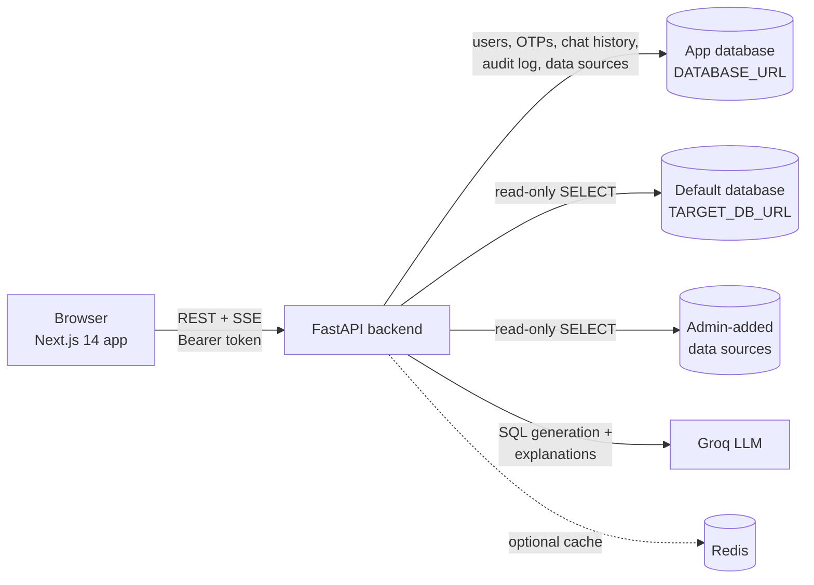

# Architecture



| Part | Technology | Role |
|---|---|---|
| Frontend | Next.js 14 (App Router), React 18, TypeScript, Tailwind CSS, Chart.js | Login, chat dashboard, SQL console, admin panel |
| Backend | FastAPI, SQLAlchemy 2 (async), Pydantic v2 | REST + Server-Sent Events API |
| App database | SQLite (dev) or PostgreSQL | Users, OTP codes, chat history, audit log, saved data sources |
| Default database | Any SQLAlchemy URL | The database questions go to unless the user picks another |
| Data sources | PostgreSQL, MySQL, SQLite, SQL Server, Oracle | Extra databases added by an admin; users choose one in the top-bar switcher |
| LLM | Groq (`llama-3.3-70b-versatile` by default) | Writes SQL, explains results |
| Chat memory | `sentence-transformers` + FAISS, in memory | Recalls relevant earlier answers in the same conversation |
| SQL safety | `sqlglot` | 11-check validator — see [Security](security.md) |
| Cache | Redis (optional) | Caches admin data-source query results for 5 minutes |

## What happens when a user asks a question

The dashboard calls `POST /ask/stream` with the question, a conversation
`session_id` and — if a database other than the default is selected —
`data_source_id` (chosen in the top-bar switcher). The response is a Server-Sent Events stream.

1. **Authenticate** — the Bearer token is checked and the user loaded
   (`core/security.py`).
2. **Recall** — the user's conversation memory (keyed by user id + session id)
   returns the 3 most similar earlier Q&A pairs (`langchain_chains/rag_memory.py`).
3. **Pick the database** — `resolve_context()` in `services/query_pipeline.py`
   returns the SQL dialect, the table list and the allowed tables for either the
   default database or the chosen data source.
4. **Write SQL** — if the question already starts with `SELECT`/`WITH` it is used
   as is; otherwise Groq writes it from the schema, told which dialect to use
   (`langchain_chains/prompts.py`).
5. **Validate** — `sql_safety/validator.py` runs the 11 checks against **that
   database's** tables and enforces a row cap (`LIMIT`, `TOP` or `FETCH FIRST`
   depending on the dialect).
6. **Run** — read-only, in a transaction that is always rolled back, with a
   statement timeout (`db/executor.py` for the default database,
   `run_on_data_source()` for data sources).
7. **`meta` event** — SQL, columns, rows and a suggested chart (`line` for dates,
   `pie` for ≤ 6 categories, otherwise `bar`, none for single values) are sent
   so the table and chart render immediately.
8. **`token` events** — Groq streams a short business explanation.
9. **`done` event** — the turn is stored in conversation memory and written to the
   audit log. The frontend then saves it to chat history (`POST /chat/save`).

Any failure produces an `error` event and is written to the audit log.

`POST /ask` does the same in one JSON response, and `POST /api/query` (the
SQL console) skips step 4. Admin write mode (`POST /admin/sql/execute`) uses its
own validator (`sql_safety/admin_writes.py`) and commits instead of rolling back.

## Uploaded files

`POST /api/analyze-file` loads a CSV or Excel file (max 10 MB, 50 000 rows) into
an in-memory, read-only SQLite database owned by the uploading user and returns a
`file_session_id`. `POST /api/ask-file` answers questions about it with the same
validation. File sessions are dropped after 1 hour idle or on server restart.

## Backend layout

```text
backend/app/
├── main.py                 app setup, start-up tasks, /health, /api/query
├── config.py               environment settings
├── api/routes/             HTTP endpoints (one file per area — see api.md)
├── core/                   security (JWT, passwords), email, avatars, rate limiting
├── db/                     default-database engine, executor, schema cache, app-DB session
├── langchain_chains/       LLM prompts, conversation memory
├── models/                 SQLAlchemy tables
├── schemas/                Pydantic request/response models
├── services/
│   ├── query_pipeline.py   shared ask/execute logic used by every query endpoint
│   ├── connection_manager.py  data-source engines, schema reading, password encryption
│   ├── sql_dialect.py      db_type / URL → sqlglot dialect
│   ├── file_session_store.py  uploaded files
│   └── query_cache.py      Redis cache
└── sql_safety/             the 11-check SQL validator
```

## Frontend layout

```text
frontend/
├── app/
│   ├── auth/               sign in, register, OTP, password reset, Google return page
│   ├── dashboard/          chat (page.tsx), SQL console (sql/), shared state (context.tsx)
│   └── admin/              statistics, users, audit log, data sources
├── components/             Navbar (database switcher), Sidebar (schema), ChartBlock, Avatar
└── lib/api.ts              API client: tokens, silent refresh, typed calls
```

The access token is kept in `localStorage`; the refresh token is an httpOnly
cookie. `authFetch()` refreshes the access token automatically when it expires.

## App database tables

| Table | Contents |
|---|---|
| `users` | Accounts, role (`user`/`admin`), verification state, avatar, `token_version` (bumped on logout / password reset to revoke tokens) |
| `otp_codes` | Current 6-digit code per email, expiry, wrong-attempt count |
| `chat_messages` | Saved Q&A turns per user |
| `audit_logs` | Every question: SQL, rows, timing, success or error |
| `data_sources` | Databases added by admins (password encrypted) |

Tables are created on start-up. New columns are added automatically by a small
migration list in `main.py` (`_COLUMN_MIGRATIONS`).
